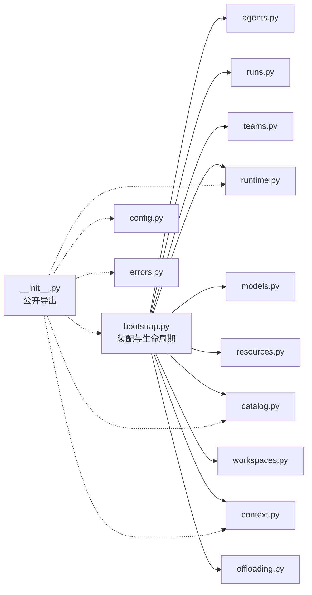
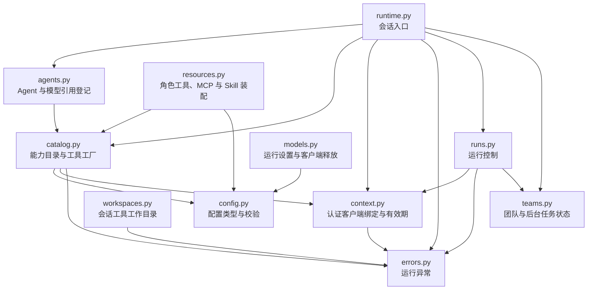

# Buying AI · ERPNext 采购助手

嵌入 ERPNext Buying 页面，结合当前单据、未保存的表单和附件进行查询与分析。请求通过 Frappe 同源接口转发到独立的 FastAPI 服务，由 AgentScope 执行模型、工具和团队协作。

| 目录             | 职责                                                            |
| ---------------- | --------------------------------------------------------------- |
| `frappe_app/`    | Frappe App `buying_ai`，包含 React 界面、页面上下文和请求转发。 |
| `assistant/`     | Agent 服务，负责身份核验、会话管理、模型和业务工具。            |
| `frappe_docker/` | 官方 Docker 仓库子模块，提供 ERPNext 开发环境。                 |

## 本地开发

需要 Docker 和 uv。Assistant 在宿主机运行，运行账户须能访问本机 Docker 服务。首次准备环境：

```bash
git submodule update --init --recursive
docker compose -f frappe_app/docker/compose.yaml up -d
cp assistant/conf/.env.example assistant/conf/.env
```

填写 `.env` 中的模型密钥和数据库密码；数据库凭据须与 Compose 的 `postgres` 服务一致。确认 `assistant/conf/app.yaml` 中的 ERPNext、数据库和服务地址后启动：

```bash
uv sync --directory assistant --locked
uv run --directory assistant python main.py
```

ERPNext：`http://development.localhost:8000`，首次初始化账号为 `Administrator` / `admin`。Assistant 默认端口为 `8100`，Frappe 通过 `BUYING_AI_AGENT_URL` 连接。Bench 自动构建并监听 `frappe_app/public/frontend/`；修改后刷新浏览器。

## runtime 文件依赖

`assistant/app/runtime/` 使用包内相对导入，配置与外部资源由宿主提供。下面的箭头表示**直接导入**，虚线表示 `__init__.py` 的公开导出。

入口与装配：



其余模块的依赖与职责：



`config.py`、`errors.py`、`teams.py`、`offloading.py` 没有包内导入；`offloading.py` 补齐前台工具被中断时的取消收尾。图中省略第三方库和按配置动态加载的业务工具。

迁移时整包复制，依赖 `agentscope[service,storage-sql]>=2.0.9,<2.1`、FastAPI 和 Pydantic；Docker 工作空间另需 `workspace-docker` 扩展。部分装配使用 AgentScope 内部 API。宿主提供 `AgentCatalog`、原生存储、消息总线、工作空间管理器、`InjectionConfig` 和上下文有效期，通过 `create_runtime()` 创建实例，以 `async with runtime` 管理生命周期。

用户标识由宿主认证后传入；发送、恢复、确认、中断、取消和删除须显式提供 `clients`，无业务客户端时传 `{}`。工具通过 `RunContext.clients` 访问客户端，宿主将 `RunError.code` 转为接口错误。

## 配置与扩展

| 位置                           | 用途                                            |
| ------------------------------ | ----------------------------------------------- |
| `assistant/conf/app.yaml`      | 服务、ERPNext、数据库、工作空间和上下文有效期。 |
| `assistant/conf/agents.yaml`   | 模型、默认入口、角色能力及允许邀请的成员。      |
| `assistant/conf/mcp.yaml`      | 原生 MCPClient 连接；角色通过 `mcps` 引用。     |
| `assistant/resources/prompts/` | 角色提示词。                                    |
| `assistant/resources/skills/`  | Skill 目录，包含 `SKILL.md` 及辅助文件。        |
| `assistant/app/tools/`         | 业务工具工厂。                                  |

模型配置中，`credential.type` 选择提供商，`params` 设置原生生成参数，无附加参数时填写 `{}`。加载时解析为原生凭据和参数对象；创建用户会话时，将凭据（含模型密钥）及序列化参数保存到框架存储。密钥从环境变量或 `.env` 读取，后续运行由框架从存储直接创建原生模型。

`context_size` 显式覆盖原生模型卡及构造器的上下文预算，`image_inputs` 控制图片输入。`client_kwargs` 通过 SDK 的 `with_options()` 应用超时、重试等连接选项；模型层不额外重试。原生凭据的 `name` 对应宿主模型配置名，用于在 Agent 装配时关联这些运行设置。YAML 配置在启动时加载，发送和恢复使用会话中保存的原生模型配置，并应用宿主运行设置。

新增角色：编写提示词和工具工厂，在 `agents.yaml` 声明能力并引用 `models` 中的模型配置名。`tool_factories` 使用 `Python模块:函数名`，工厂接收 `RunContext` 并返回原生工具。需要协作时在 `members` 声明可邀请角色；`context`、`react` 分别使用原生 `ContextConfig`、`ReActConfig`。

Skill 的 frontmatter 须包含 `name` 和 `description`，其中 `name` 与目录名一致。模型、角色、工具工厂、MCP 和 Skill 引用在启动时校验。

## 会话与运行

Assistant 入口为 `POST /sessions`，Frappe 代理入口为 `/api/method/buying_ai.api.sessions`。使用 `action` 指定操作、`session_id` 标识会话、`sid` 核验 ERPNext 登录身份，会话按站点和用户隔离。

| action                       | 行为                                                                   |
| ---------------------------- | ---------------------------------------------------------------------- |
| `create` / `list` / `rename` | 创建、列出和重命名用户会话。                                           |
| `send`                       | 发送新输入并绑定认证客户端。                                           |
| `interrupt`                  | 中断当前回复或结束工具确认／外部结果等待，保留后台工具和成员 Agent。   |
| `resume`                     | 界面的「继续执行」：加载已保存上下文，通过原生空输入继续当前会话推理。 |
| `cancel`                     | 取消当前会话的回复及后台工具，保留上下文和团队；不结束工具确认等待。   |
| `confirm`                    | 提交原生工具权限确认结果。                                             |
| `messages` / `subscribe`     | 读取完整消息与运行状态／订阅原生 SSE 事件。                            |
| `upload`                     | 上传附件到会话工作空间。                                               |
| `delete`                     | 停止并删除会话及其团队资源。                                           |

关闭页面只断开订阅，任务继续执行。中断或取消不会冻结团队，成员消息和后台结果仍可原生唤醒会话。服务重启后，符合恢复条件的会话可点击「继续执行」；未完成的后台工具和成员任务不会因此重启。

业务客户端仅保存在服务端内存，成员沿用负责人会话绑定的用户身份。上下文过期或服务重启后须通过认证请求重新绑定；当前使用单 worker。

工作空间按站点和用户隔离，同一用户共享容器。宿主文件保存在 `assistant/data/workspaces/<workspace_id>/`，会话目录为 `/workspace/sessions/<session_id>/`，附件位于其中的 `attachments/`。Agent 可访问同一用户其他会话的文件；删除会话清理该会话目录，容器回收保留挂载文件。

Bash 和内置文件工具在容器执行，ERPNext 工具在服务端执行并遵守用户权限。工具运行超过 10 秒后由框架转入后台，结果可自动唤醒推理。`image_inputs` 启用时直接传入图片内容，其他附件由工具按需读取。
